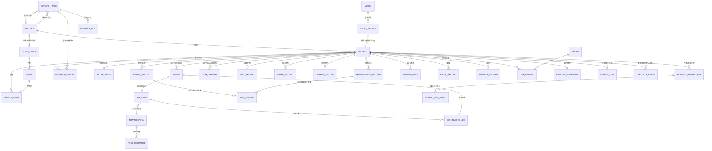

# 车辆管理系统 · 数据实体关系说明（E-R）

| 属性 | 内容 |
| --- | --- |
| 产品名称 | 车辆管理系统 |
| 文档名称 | 数据实体关系说明（E-R） |
| 文档版本 | V1.0 |
| 创建日期 | 2026-10-13 |
| 最后更新 | 2026-10-13 |
| 文档状态 | 待确认 |

---

## 版本记录

| 版本 | 修改日期 | 修改内容 | 备注 |
| --- | --- | --- | --- |
| V1.0 | 2026-10-13 | 初始创建：梳理以车辆为主线的全部业务对象、主键、外键与基数关系，输出 E-R 图、关系明细、约束规则及文档缺口清单 | 依据现有 02-产品文档全部 PRD 与高保真页面数据模型整理 |

---

## 1. 文档目的与范围

本文档用于说明本系统中**车辆、设备、SIM 卡、费用**等业务对象之间的数据关系，作为后续数据建模、接口对接与模块扩展的共同口径依据。

**范围**：覆盖车辆管理、运行监管、费用管理三个已具备数据模型的域，以及维保、合规与风险、退出管理等已引用但尚未建设的域。

**依据来源**：

| 来源 | 用途 |
| --- | --- |
| `02-产品文档/` 全部 PRD | 实体字段、业务规则与约束口径 |
| `00-方案/关于车辆生命周期的事件定义.md`、`关于车辆可用性的讨论.md`、`关于智能网联终端费用的调研.md` | 生命周期事件、可用性规则、设备与流量模型 |
| `03-高保真页面/` 页面数据模型（车辆资产详情、设备台账、费用台账、调度详情等） | 字段级交叉验证 |

> **凡文档未明确者，本文统一标注「文档未明确」，不做推断填充。**

---

## 2. 建模原则

以下四条是本系统数据关系的基本特征，也是画 E-R 时最容易出错的地方：

1. **车辆（VIN）是唯一主线与事实主键**
   车架号 `vin_code` 全局唯一；车牌号为选填、无唯一校验，**不能作为唯一键**。二维码、标签关联、售后表、费用台账均锚定 VIN。

2. **设备与 SIM 卡是「当前唯一 + 历史可换绑」的时态关系**
   「同一张 SIM 卡同一时间只能绑定一个设备」是**当前时点约束**；换绑会写入绑定历史，因此从时间维度看是多对多。

3. **费用是「派生聚合」，不是独立维护的业务数据**
   加油/加水/充电/流量费用各自独立录入或核算，单车费用台账仅为**查询视图**，不独立存储、不独立录入。

4. **业务状态与实时状态分离**
   业务状态（调度中、维修中、保养中、已报废等）只由**业务流程**变更；设备上报的实时故障、离线、低电量只影响「可用性」派生结论，**不得直接改写业务状态**。

---

## 3. 实体总览

| 域 | 实体 | 主键（文档口径） | 明确度 |
| --- | --- | --- | --- |
| 主数据 | 项目（归属项目） | 文档未定义 | 未明确 |
| 主数据 | 车型 | 车型名称（中）、车型编码全局唯一 | 部分明确 |
| 主数据 | 车型版本 | （车型 + 车型版本号）复合，同车型下唯一 | 部分明确 |
| 主数据 | 标签组 / 子标签 | `group_id` / `label_id` | 明确 |
| 主数据 | 车辆—标签关联 | `rel_id`；唯一 `(vin_code, label_id, is_deleted=0)` | 明确 |
| 车辆 | 车辆档案 / 车辆资产 | `vin_code` 车架号（全局唯一） | 明确 |
| 设备接入 | 设备（T-Box / ADU / OBU / DTU / 视频盒子） | 设备识别码（唯一） | 明确（页面层） |
| 设备接入 | SIM 卡 | `IMSI` | 明确 |
| 设备接入 | 流量池 | 流量池代码 | 明确 |
| 业务单据 | 调度任务 | `task_no`（DB+年月日+4 位流水） | 明确 |
| 业务单据 | 调度车辆明细 | 文档未定义 | 未明确 |
| 业务单据 | 售后信息 | `vin_code`（主键，1:1 车辆） | 明确 |
| 业务单据 | 维修记录 / 保养记录 | `id` 自增；`work_order_no` 为业务幂等键 | 明确 |
| 业务单据 | 出厂 BOM / BOM 变更记录 | 文档未定义（建议 `vin_code + part_no`） | 未明确 |
| 业务单据 | 部件 | `part_no` 件号 | 明确 |
| 费用 | 加油 / 加水 / 充电记录 | 文档未定义（无单据号） | 未明确 |
| 费用 | 车辆月度流量费用 | （`vin_code` + 统计月份）唯一 | 明确 |
| 费用 | 单车费用台账 | 派生视图（`vehicle_id/VIN`） | 明确 |
| 运行 | 运行数据（遥测） | （VIN + 数据采集时间）时序 | 推断 |
| 运行 | 车辆故障信息 / 车辆异常记录 | 文档未定义 | 未明确 |
| 运行 | 用车记录 | 文档未定义 | 未明确 |
| 运行 | 实时快照 | （车辆标识，1:1） | 派生 |
| 审计 | 车辆变更日志 / 车型日志 / 版本日志 | 文档未明确 | 未明确 |
| 派生 | 车辆生命周期事件 | 无独立主键（来源于业务记录） | 派生 |

---

## 4. 核心 E-R 图

### 4.1 关系图（Mermaid）



### 4.2 关系图（ASCII 概览）

```
                        车型 1 ──N 车型版本
                                      │ N:1  ← 引用锚定在「版本」维度
       项目(字典) ──N:1──► 【 车 辆 】 ◄──N:N── 子标签 ──N:1── 标签组 ──N:1(私有)── 项目
        (归属项目)          VIN 全局唯一
                                │
      ┌──────────┬──────────────┼───────────────┬──────────────┬─────────────┐
      │ 1:N      │ 1:N          │ N:N           │ 1:N          │ 1:1         │ 1:N
      ▼          ▼              ▼               ▼              ▼             ▼
   设备台账     费用记录      调度任务        维修/保养      售后信息      运行数据/故障/
   (N:1 车辆)   (N:1 车辆)   (经单车明细)     记录(工单)    (质保/服务商)  异常/轨迹/用车记录
      │ 1:1(当前)
      ▼
   SIM 卡 ──N:1──► 流量池 ──1:N──► 流量池充值费用 ──► 单位成本(元/GB)
   (IMSI)                                                    │
                                                             ▼
                                        车辆月度流量费用(车×月) ──1:N──► 按卡拆分明细
```

---

## 5. 关系明细

### 5.1 车辆与主数据（静态归属）

| 关系 | 外键 | 基数 | 业务语义与约束 |
| --- | --- | --- | --- |
| 车辆 → 车型版本 | `model_name` + `model_version` | **N:1** | 引用**锚定在「车型版本」**，车型本身不被车辆直接引用；无版本车型不能被车辆引用 |
| 车型 → 车型版本 | 车型版本号 | **1:N** | 一车型 0~N 版本；同车型下版本号不可重复 |
| 车辆 ↔ 子标签 | `vin_code` / `label_id` | **N:N** | 经 `vehicle_label`；车辆关联的是**子标签**，标签组仅为容器；打标不改变车辆状态与归属项目 |
| 标签组 → 子标签 | `group_id` | 1:N | 固定两级，不支持更深层级 |
| 车辆 → 项目 | 归属项目 | N:1 | 项目同时被标签组（私有）、调度前后项目引用；**项目主数据无表定义** |
| 车辆 → 变更日志 | `vin_code` | 1:N | 字段级审计；车型级 / 版本级日志**分域隔离**，不合并 |

> **说明**：车辆建档与车辆资产**不是两个实体**，是同一车辆实体的录入阶段与运营管理阶段，字段直接引用、以 VIN 标识。

### 5.2 车辆 ↔ 设备 ↔ SIM 卡 ↔ 流量池

| 关系 | 外键 | 基数 | 业务语义与约束 |
| --- | --- | --- | --- |
| 设备 → 车辆 | 车辆 VIN | **N:1（当前）** | 一车可装多个终端（T-Box + ADU + 视频盒子…），页面示例已有一车多终端 |
| SIM 卡 → 设备 | `IMSI` ↔ 设备识别码 | **1:1（当前）** | 「同一张 SIM 卡同一时间只能绑定一个设备」 |
| SIM 卡 ↔ 车辆 | 经设备间接关联 | **当前 N:1，历史 N:N** | 换绑写入绑定历史（绑定 / 解绑 / 更换） |
| 车辆档案 → SIM 卡台账 | `IMSI` | 校验引用 | 车辆硬件行填 IMSI 时须**台账已登记且未被其他硬件占用** |
| SIM 卡 → 流量池 | 流量池代码 | N:1 | 池内 SIM 卡共享单位流量成本 |
| 流量池 → 充值费用 | 流量池 + 年月 | 1:N | 外部核算数据，本期由其他核算模块接入 |
| 流量池 → 单位成本 | 流量池 + 年月 | 1:1 | `单位成本 = 池当月充值费用 ÷ 池实际使用总量` |

**关键口径**：`车辆 — 设备 — SIM 卡` 不是简单 1:1:1，而是 **车辆 1:N 设备、设备 1:1 SIM（当前）、SIM N:1 流量池**，且绑定关系全部留历史。

### 5.3 车辆与业务单据

| 关系 | 外键 | 基数 | 业务语义与约束 |
| --- | --- | --- | --- |
| 调度任务 ↔ 车辆 | `task_no` / `vin_code` | **N:N** | 经**调度车辆明细**解耦：一张单含多辆车，单车级出库状态、交接状态、是否确认接收挂在明细行上 |
| 调度任务 → 项目 | `from_project` / `to_project` | N:1 ×2 | 移出方 / 接收方；**同一申请内所有车辆必须同属一个项目** |
| 调度任务 → 流程日志 | `task_no` | 1:N | 不可篡改 |
| 售后信息 → 车辆 | `vin_code`（**主键**） | **1:1** | 质保政策、服务商、维保计划、附件；建档与详情页**共享同一份数据** |
| 维修记录 → 车辆 | `vin_code` | 1:N | 售后系统推送，本系统只读；`work_order_no` 为幂等键 |
| 保养记录 → 车辆 | `vin_code` | 1:N | 同上；完成后**自动更新维保计划**（首保日期、下次保养提醒） |
| 工单 → 车辆状态 | `vin_code` | 驱动 | 工单创建 → 「在库-维修 / 在库-保养中」；完成或取消 → **回退到创建前状态** |
| 出厂 BOM → 车辆 | `vin_code` | 1:N（一车一份） | **仅资产来源 = 自研**的车辆才有；MES 同步的静态快照 |
| BOM 变更 → 车辆 | `vin_code` | 1:N | 零部件变更**嵌套在工单中推送**，不单独推送；按 `part_no` 与出厂 BOM 逻辑合并 |
| 部件 | `part_no` | — | 件号唯一；按车辆实例（VIN）挂接；**「部件 → 车型」关系文档未明确** |

### 5.4 车辆与费用

| 关系 | 外键 | 基数 | 口径 |
| --- | --- | --- | --- |
| 加油 / 加水 / 充电 → 车辆 | **车牌号** | 1:N | 能耗台账**未使用 VIN**；按**发生日期**归集 |
| 车辆月度流量费用 → 车辆 | `vin_code` + 统计月份 | 1:N（每车每月唯一） | 按**自然月**归属，不做按日摊分 |
| 月度流量费用 → SIM 卡 | `IMSI` | 1:N | 单卡费用 = 卡当月用量 × **该卡所属池**单位成本；一车多卡分别计算后求和 |
| 单车费用台账 → 全部费用 | `vehicle_id/VIN` + `expense_type` + `expense_date` + `amount` + `source_module` + `source_bill_id` + `status` | 1:N | **派生视图**，不独立存储、不独立录入 |

> **口径差异提示**：能耗费用按车牌号、流量费用按 VIN + 月份、单车费用台账强制 VIN（原文「不能仅以车牌号作为唯一键」）——三者需在建模时归一到 VIN。

### 5.5 车辆与运行数据

| 关系 | 外键 | 基数 | 业务语义与约束 |
| --- | --- | --- | --- |
| 运行数据 → 车辆 | `vin_code` + 采集时间 | 1:N | **时序数据**（位置、速度、姿态、档位、SOC、作业模式等） |
| 车辆故障信息 → 车辆 | `vin_code` | 1:N | 主动上报故障码；**不展示等级与处理状态，前端不得推断** |
| 车辆异常记录 → 车辆 | `vin_code` | 1:N | 策略触发（超时停靠 / 超速 / 限行区） |
| 用车记录 → 车辆 / 司机 | 关联车牌号 / 司机名称 | N:1 | 「司机 × 车辆 × 时间」三元事件，含派生字段用车时长、轨迹里程 |
| 实时快照 → 车辆 | 车辆标识 | **1:1** | 缓存视图，承载数据质量字段（来源 / 采集时间 / 接收时间 / 质量 / 说明） |
| 生命周期事件 → 车辆 | `vin_code` | 1:N | **派生视图**，来源为各业务单据，不在本页维护 |

**硬约束**：故障与异常是**两张独立表，禁止合并**；运行、故障、异常数据**不直接写入生命周期**。

### 5.6 派生视图与审计

| 对象 | 性质 | 说明 |
| --- | --- | --- |
| 车辆生命周期事件 | 派生视图 | 只读时间线，内容以来源业务记录为准；来源修正时同步更新，不新增重复事件 |
| 单车费用台账 | 派生视图 | 统一读取各费用明细，按车辆聚合 |
| 实时快照 | 派生视图 | 车辆总览与运行监控共享 |
| 变更日志 | 审计实体 | 车辆级、车型级、版本级**分域记录**；BOM 变更日志与车辆变更日志独立维护，不合并 |

---

## 6. 关键约束汇总

| 约束 | 内容 |
| --- | --- |
| 车辆唯一性 | 车架号 `vin_code` 全局唯一；车牌号不可作唯一键 |
| SIM 唯一绑定 | 同一张 SIM 卡同一时间只能绑定一个设备 |
| SIM 校验 | 硬件行填写的 IMSI 必须已在 SIM 卡台账登记且未被占用 |
| 调度一致性 | 同一调度申请内所有车辆必须同属一个项目，且状态为「在库-闲置可调出」 |
| 删除引用校验 | 版本删除校验关联车辆数（>0 阻断）；车型删除仅校验是否仍存在版本；标签组有子标签则阻断 |
| 逻辑删除 | 车辆、标签、标签组、关联关系均为逻辑删除，保留数据用于溯源 |
| 状态隔离 | 实时数据不得覆盖业务状态；业务状态仅由流程变更 |
| 幂等 | 售后工单以 `work_order_no` 为幂等键，工单与零部件变更必须同时写入成功 |

---

## 7. 文档缺口与待确认项

### 7.1 缺口清单

| 缺口 | 影响 |
| --- | --- |
| 项目 / 组织 / 用户 / 角色**无表定义** | 归属项目是被 5 处引用的核心字典，却是空白 |
| 设备主键在监管域未定义 | 设备台账页已定为「设备识别码」，监管 PRD 仍按 VIN 表述 |
| 能耗费用**未使用 VIN** | 与单车费用台账「不能仅以车牌号作唯一键」冲突 |
| 加油 / 加水 / 充电**无单据号** | 无法作为 `source_bill_id` 的被引对象 |
| SIM 卡绑定记录表**未列 IMSI** | 按现有表头无法反查卡 |
| 车辆状态枚举存在两套 | 建档与资产模块口径不一致 |
| 调度车辆明细、BOM、变更日志主键未定义 | 无法唯一标识行记录 |
| 部件与车型的关系未定义 | 无法支持「车型标准 BOM」类需求 |

### 7.2 待确认项

1. 车辆归属项目是否需要保留**历史归属记录**（现表仅单一 `project_name`）？
2. 能耗费用是否统一改用 VIN 作为外键，以消除与流量费用、单车费用台账的口径差异？
3. 车载终端是否需要建立独立主数据表与「终端—车辆」绑定历史表？
4. 项目、组织、用户、角色主数据由本系统维护还是外部接口提供？
5. 「部件 → 车型」是否需要建立标准 BOM 关联，还是维持当前的车辆实例维度？

---

## 8. 参考来源

| 类型 | 文件 |
| --- | --- |
| PRD | 车辆建档PRD、车辆资产管理PRD、车型管理PRD、标签管理PRD、调度管理PRD、售后维保PRD、SIM卡管理PRD、流量费用明细PRD、能耗费用台账PRD、单车费用管理_PRD、车辆实时监管PRD、车辆运行监控PRD、车辆运营-用车记录PRD、系统导航布局PRD |
| 方案 | 单车360度档案与运行状态监管方案、关于车辆生命周期的事件定义、关于车辆可用性的讨论、关于智能网联终端费用的调研、关于流量与AI推理费用的建模、售后管理系统对接需求分析 |
| 页面数据模型 | 车辆资产详情、设备台账列表、SIM 卡管理、费用管理（加油/加水/充电/流量）、调度详情、用车记录、监管四页 |
